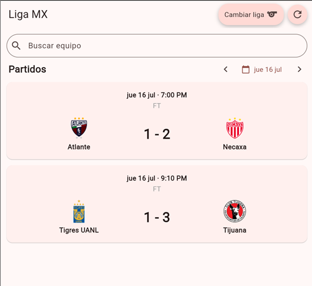
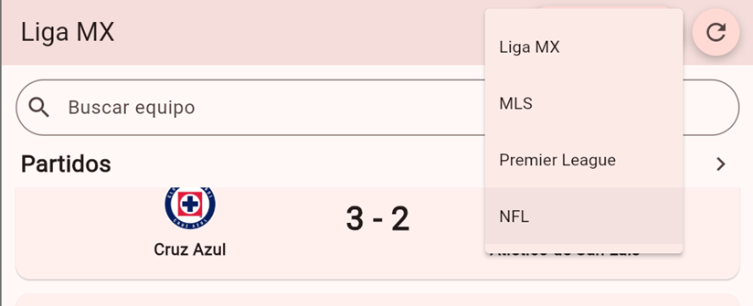
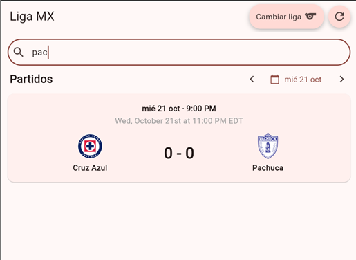

# Sports Scoreboard App

Aplicación móvil desarrollada con **Flutter y Dart** que permite consultar resultados y calendarios de partidos de distintas ligas deportivas. Los datos se obtienen de un endpoint no oficial de ESPN, en formato JSON.

> Proyecto con fines educativos y de aprendizaje.

## Características

- Partidos del día de la Liga MX al abrir la app.
- Cambio de liga: Liga MX, MLS, Premier League y NFL.
- Consulta de cualquier fecha con flechas o calendario, para ver resultados pasados y próximos partidos.
- Búsqueda de partidos por nombre de equipo.
- Fecha y hora convertidas a la hora local del dispositivo.
- Botón de recarga y gesto de deslizar hacia abajo para actualizar.
- Mensajes claros cuando hay errores de conexión o no hay partidos.

## Capturas de pantalla

| Partidos del día | Selector de liga | Búsqueda |
|---|---|---|
|  |  |  |

## Tecnologías

- **Flutter / Dart**
- Paquete [`http`](https://pub.dev/packages/http) para consumir la API
- Material Design 3
- `FutureBuilder` para manejar los estados de carga, éxito y error

## Cómo funciona

1. La app hace una petición HTTP GET al endpoint `scoreboard` de la liga y fecha seleccionadas.
2. La respuesta JSON se convierte en objetos del modelo `Game`.
3. La interfaz muestra cada partido en una tarjeta con logotipos, marcador, fecha y estado.

## Cómo ejecutarlo

Requisitos: Flutter SDK y Android Studio (con un emulador o un dispositivo conectado).

```bash
git clone https://github.com/Gerardo-G-Rodriguez-dev/sports-scoreboard-app.git
cd sports-scoreboard-app
flutter pub get
flutter run
```

Para generar el APK: `flutter build apk`. La app necesita el permiso `INTERNET` en `android/app/src/main/AndroidManifest.xml`.

## Documentación

Consulta el [reporte con la guía de uso](Reporte_Sports_Scoreboard_app_RodriguezGerardo.pdf) para ver el funcionamiento paso a paso.

## Aviso

Este es un proyecto educativo sin fines de lucro. No está afiliado, respaldado ni patrocinado por ESPN ni por las ligas o equipos mencionados. Los nombres, logotipos y marcas pertenecen a sus respectivos propietarios. Los datos provienen de un endpoint no oficial y sin documentación, que puede cambiar o dejar de funcionar sin previo aviso.

## Autor

Gerardo Rodriguez · Estudiante de Ingeniería en Computación